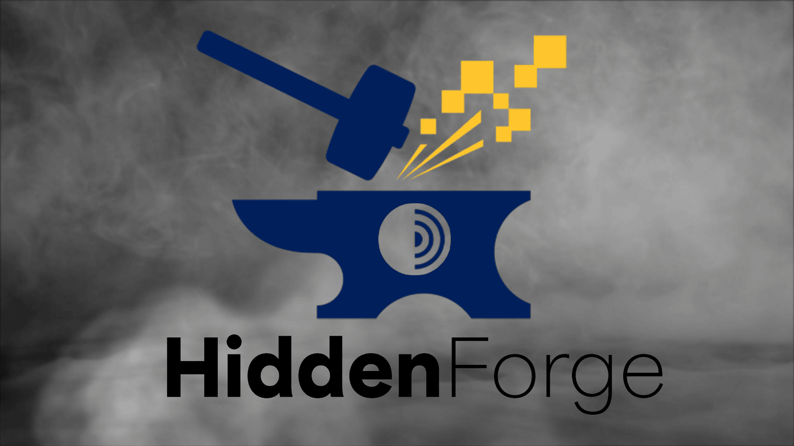

# HiddenForge

**Pull it:**

```bash
docker pull sambent.dev/sam/hiddenforge   # the maintainer's own registry
docker pull doingfedtime/hiddenforge      # Docker Hub
```

Both serve the identical digest, and the same signatures verify either one — use
whichever you prefer.

**Verify what you pulled** (signatures + reproducible build): the [verification guide](https://sambent.dev/sam/HiddenForge/wiki/Verifying-the-Image).

**Documentation:** the full guide lives in the [wiki](https://sambent.dev/sam/HiddenForge/wiki).



## Quick Start (3 steps)

`docker compose up` pulls the image (`sambent.dev/sam/hiddenforge`) automatically, so this is all you need:

```bash
# 1. Download the compose file
curl -O https://sambent.dev/sam/HiddenForge/raw/branch/master/docker-compose.yml

# 2. Edit the lines marked <-- EDIT in docker-compose.yml
#    - Change MYAPP to your service name (e.g. BLOG, TIPSITE)
#    - Replace nginx:alpine with your actual backend image

# 3. Start it
mkdir -p ./tor-keys
docker compose up -d

# Your .onion address appears here once Tor bootstraps (first boot: a few minutes, up to ~6):
# Replace "myapp" with whatever you named your service in step 2
docker compose exec tor cat /var/lib/tor/hidden_service/myapp/hostname
```

All security flags are pre-configured in the compose file. The backend service
is network-isolated and never exposed to the internet.

**What it is:** a hardened Tor hidden service container: Tor 0.4.9.13 on Alpine
3.23 with Tor's built-in vanguards-lite pinned on, plus the Vanguards addon's
bandguards and rendguard attack detectors. Every dependency is pinned (pip ones
by SHA256, apk ones against Alpine's signed index), the build is reproducible,
and it is built for a state-level adversary threat model.


---

## Adopt it programmatically (CLI + machine contract)

Editing a compose file by hand and building `mkp224o` yourself are no longer
required. The `hiddenforge` CLI emits a merge fragment, and the vanity generator
ships **inside the image**.

```bash
# 1. Emit a ready-to-merge fragment (does not touch your files)
hiddenforge setup --backend web:80 --name myapp --out ./deploy

# 2. Merge and start — your app needs no ports and no Tor code
docker compose -f compose.yml -f ./deploy/compose.service.yml up -d

# 3. Read the .onion (also written to ./tor-keys/myapp.onion)
hiddenforge show --keys ./tor-keys --name myapp --json
```

The CLI is a single file, `scripts/hiddenforge` in this repository: Python 3.10
or later, standard library only, nothing to `pip install`. Install it where
`sudo` also finds it (`backup` needs root under Docker):
`sudo install -m 0755 scripts/hiddenforge /usr/local/bin/hiddenforge`.

Subcommands: `setup`, `info`, `version`, `show`, `status`, `doctor`, `vanity`,
`backup`, `restore`, `rotate`, `encrypt-key`, `decrypt-key`, `verify-image`,
`sbom`. Every one supports
`--json`, never prompts off a TTY, and uses stable exit codes. `vanity --bench`
prints the honest time estimate for a prefix on your machine before you start.

**→ Full integrator guide: [docs/INTEGRATION.md](docs/INTEGRATION.md)**

The image is also self-describing and self-contained:

```bash
docker run --rm sambent.dev/sam/hiddenforge:latest version --json
docker run --rm sambent.dev/sam/hiddenforge:latest info --json   # the machine contract
```

---

## What the Compose File Does

The included `docker-compose.yml` is ready to use as-is. It handles everything:

| What | How |
|---|---|
| Drops all Linux capabilities | `cap_drop: ALL` |
| Prevents privilege escalation | `security_opt: no-new-privileges:true` |
| Two stacked seccomp filters | runtime default profile + Tor's `Sandbox 1` |
| Read-only container filesystem | `read_only: true` |
| No host-side log file | `logging: driver: none` |
| Network-isolated backend | `internal: true` network, no `ports:` on backend |
| No DNS query leaves the tor container | `dns: 127.0.0.1` (backend names still resolve internally) |
| Key persistence | `./tor-keys` volume mount |

The only two lines you need to edit are flagged with `<-- EDIT`.

---

## Environment Variables

- `{NAME}_TOR_SERVICE_HOSTS` sets the hidden service port mappings.
  - Three-part `"80:web:80"` routes onion port 80 to Docker service `web` on port 80.
  - Two-part `"80:8080"` routes onion port 80 to `127.0.0.1:8080` (same-container only).
  - Multiple ports: `"80:web:80,443:web:443"`
  - `NAME` is lowercased and used as the service directory name (underscores become hyphens).
  - Docker service names resolve to IP addresses at startup, so no static IPs are required.

> **A recreated backend is followed automatically.** Tor accepts only IPs, so the
> service name is resolved at startup and the IP written into the torrc. When the
> backend is recreated and comes back on a different IP, the supervisor notices
> (it re-resolves every 30 seconds and acts only when two successful lookups in a
> row no longer include the old IP) and exits, so the container's restart policy
> starts it again with a fresh lookup; the `.onion` address does not change.
> Measured: the onion followed a moved backend within about a minute, and a
> backend that was simply down caused no restart at all. A backend whose name does
> not resolve yet when the container starts (after a host reboot the runtime starts
> containers in no particular order) is watched the same way: its service is left
> out, and once the name resolves the container restarts and configures it
> (measured: restarted 39 seconds after the backend came up, then served it).
> Until then `hiddenforge status` is not ready and lists the mapping as dropped.
> This relies on a restart policy, which both shipped compose files set
> (`restart: unless-stopped`; `always` in the Podman file, see below).

- `TOR_SANDBOX` set to `0` disables `Sandbox 1` (default: `1`)

---

## Supply Chain Security

Recent supply chain attacks (xz-utils, PyPI package hijacks, compromised npm
packages) have made dependency pinning essential for any security-sensitive
software. HiddenForge pins every dependency at every layer.

**What is pinned and why:**

| Dependency | Pinned to | Why it matters |
|---|---|---|
| Alpine base image | `alpine:3.23.5@sha256:...` | Digest pinning locks the exact OS bytes. A tag like `latest` or even `3.23.5` can be silently updated on the registry |
| `tor` apk | `0.4.9.13-r0` | A tampered Tor binary could de-anonymise every circuit |
| `python3` apk | `3.12.14-r0` | The Python runtime executes the entrypoint and Vanguards |
| `su-exec` apk | `0.3-r0` | This binary performs the privilege drop to the `tor` user |
| `openssl` apk | `3.5.8-r0` | Pinned explicitly rather than inherited from the base image, so a known-vulnerable OpenSSL cannot ride in with it |
| `py3-pip` apk | `25.1.1-r1` | Build-only; pinned so it can't be updated to a version that silently ignores `--require-hashes` |
| `mkp224o` source | commit `5172c0fd` + SHA256 | The vanity generator, vendored as a tarball the Dockerfile hash-checks before building it |
| `vanguards` pip | `0.3.1` + SHA256 | Guard protection addon; a compromised version could leak circuit topology |
| `stem` pip | `1.8.2` + SHA256 | Tor controller library; underpins all Vanguards communication |
| `setuptools` pip | `82.0.1` + SHA256 | Build dep for stem; uninstalled post-build but listed for hash verification completeness |

**How hash verification works:**

pip's `--require-hashes` flag makes the build abort with a clear error if any
downloaded file's SHA256 does not match what is recorded in `requirements.txt`.
A compromised PyPI package, even one with the correct version number, cannot
enter the image silently. The build fails.

**How apk packages are verified:**

apk packages are not pinned by an explicit SHA256 in the Dockerfile the way pip
packages are (with `--require-hashes`), but they are **not unverified**: apk
authenticates every package against a cryptographically **signed package index**
(`APKINDEX.tar.gz`, validated against the Alpine signing keys in
`/etc/apk/keys`), and each package record carries a checksum anchored by that
signed index. (The legacy index signature is SHA1-based; the practical integrity
anchor is the signed index plus the exact-version pin, not the hash algorithm.)

Be aware of the limit this has, because it is easy to overstate. `apk add
--no-cache` fetches the index from `dl-cdn.alpinelinux.org` **at build time** —
digest-pinning the base image does *not* freeze it. The exact-version pin
(`=3.12.14-r0`) still makes the resolved package deterministic: apk installs that
version or fails, never a silently newer one. But Alpine **prunes superseded
versions** from the index, so a pin that was valid at release time stops
resolving once a security update lands, and the build fails outright rather than
drifting. That is the safe failure mode, and it is the intended one — but it does
mean a source build of an older tag will not necessarily reproduce, and pinned
versions must be refreshed as Alpine moves. This has now bitten the project
three times: `tor=0.4.9.8-r0` (fixed in 2.0.2), `python3=3.12.13-r0` (fixed in
2.0.4) and `tor=0.4.9.12-r0` (fixed after 2.1.0). A scheduled CI job
(`pin-freshness`) checks every pin against the live index so the next one is
caught before a build needs it.

**Updating pinned versions:**

When you upgrade, do not just change version numbers. Verify the new hashes
first:

```bash
# Get the new SHA256 for a pip package:
pip download vanguards==0.3.2 -d /tmp/dl --no-deps
sha256sum /tmp/dl/vanguards-0.3.2*.whl

# Then update requirements.txt with the new version and hash,
# rebuild, and verify the build passes before deploying.
```

---

## Verifying the Image

Build-time pinning protects what goes *into* the image; signing and reproducible
builds let you verify the image you *pull*.

Released images are signed two independent ways over the image digest, with no
dependency on any external service or transparency log: a **post-quantum
ML-DSA-65** signature (FIPS 204) and a **hardware YubiKey** (SSH-FIDO2)
signature. The verification files live in `signatures/`. The build is also
**reproducible**, so you can rebuild from source and confirm you get a
byte-for-byte identical image.

```bash
# both verify with stock tools, offline (run inside signatures/)
# ML-DSA-65 with stock OpenSSL 3.5 or later (strip pqsign's 16-byte headers,
# wrap the raw key as a SubjectPublicKeyInfo, verify)
tail -c +17 sambent-mldsa.pub > /tmp/mldsa.key
tail -c +17 hiddenforge.digest.mldsa > /tmp/mldsa.sig
{ printf '\060\202\007\262\060\013\006\011\140\206\110\001\145\003\004\003\022\003\202\007\241\000'
  cat /tmp/mldsa.key; } > /tmp/mldsa.der
openssl pkeyutl -verify -pubin -keyform DER -inkey /tmp/mldsa.der \
  -in hiddenforge.digest -sigfile /tmp/mldsa.sig
ssh-keygen -Y verify -f allowed-signers -I sam@sambent.com -n file \
  -s hiddenforge.digest.sig < hiddenforge.digest

# confirm that digest is what the registry actually serves
skopeo inspect --raw docker://sambent.dev/sam/hiddenforge:latest | sha256sum
```

Check the keys before trusting a result. Signature files verify against
whatever public key sits beside them, so the keys are the trust anchor and must
match these values, which are also pinned in `scripts/hiddenforge`:

```
ssh-keygen -lf allowed-signers   # SHA256:wL6piZbyXpTOzT7Z66f/Q+vegj0Ml0ZwVouGJ06+3Q0
                                 # SHA256:YcUo1tBtj+Mlnpv9QpsWnJcMt77B4SipyD6OWSMjMB4
sha256sum sambent-mldsa.pub      # 4ae873ade7ee596c815f55f3052c0f01020b1817f86eaf15ab67c8fc77cbfd22
```

Releases up to 2.0.3 additionally carried a cosign signature (`cosign.pub` is
kept in the repo so those older releases stay verifiable). From 2.0.4 cosign is
no longer used: it was the last part of the flow that depended on external
tooling, and the ML-DSA + hardware pair is the attestation.

The CLI wraps the digest check and both signature checks in one command. It
verifies against the pinned keys, never against keys found in the signature
directory, and it refuses (exit 1) when the ML-DSA half cannot be checked unless
you pass `--allow-classical-only`. It reads the signatures from `./signatures`,
so run it from the root of this repository or pass `--sigdir`:

```bash
hiddenforge verify-image sambent.dev/sam/hiddenforge:latest --json
hiddenforge sbom --image sambent.dev/sam/hiddenforge:latest --out hf.spdx.json
```

(`sbom` runs on the host: it drives a digest-pinned syft container through the
Docker socket, which the hiddenforge image deliberately does not have.)

For the strongest guarantee, pin the verified digest in your compose file instead
of the mutable `:latest` tag. Full step-by-step verification, both signatures
plus reproducing the build, is in the wiki:

**→ [Verifying the Image](https://sambent.dev/sam/HiddenForge/wiki/Verifying-the-Image)**

---

## Offline Key Generation (Recommended for High-Risk Deployments)

By default the container generates hidden service keys on first run on the
production host. For a state-level adversary threat model, generate keys
**offline** on an air-gapped machine so the private key never touches the
production host in plaintext.

```bash
# Option A: the vanity generator built into the image (mkp224o, pinned and
# hash-checked in the Dockerfile). Pull the image while online, then on the
# air-gapped machine -- the generator container itself also runs with no network:
hiddenforge vanity --prefix myprefix --name myapp --keys ./keys --bench   # how long?
hiddenforge vanity --prefix myprefix --name myapp --keys ./keys           # writes ./keys/myapp/

# Option B: run Tor once on an air-gapped machine, let it generate
# keys, copy the service directory out, then wipe the machine.
```

**Mount pre-generated keys:**

```bash
# Service directory must contain:
#   hostname                (your .onion address, plaintext)
#   hs_ed25519_secret_key   (binary, keep offline backups, never share)
#   hs_ed25519_public_key   (binary)

mkdir -p ./tor-keys/myapp
cp /path/to/offline/keys/* ./tor-keys/myapp/
chmod 700 ./tor-keys/myapp
chmod 600 ./tor-keys/myapp/hs_ed25519_secret_key

docker compose up -d
```

**Back up `hs_ed25519_secret_key` before the container runs.** Losing it means
losing your .onion address permanently, with no recovery.

---

## Log Handling

Inside the container, Tor runs with `SafeLogging 1` (IPs and .onion addresses
scrubbed from output) and `AvoidDiskWrites 1` (no log files written to disk).

The compose file sets `logging: driver: none` so Docker does not write a JSON
log file on the host either. Remove that block if you need logs for debugging:

```yaml
logging:
  driver: "json-file"
  options:
    max-size: "10m"
    max-file: "1"
```

---

## What HiddenForge Cannot Protect You From

This container hardens the *Tor layer*. Historically, that is almost never the
layer that gets an onion service located. The service is usually found because
the **application behind it** told someone where it lives. Nothing in this image
can stop that, so it is on you:

| Leak | What happens | What to do |
|---|---|---|
| Backend makes outbound requests | Your app fetches an avatar, a font, an update check, or sends error telemetry — **directly**, over clearnet, from the server's real IP. One request is enough. | Keep the backend on the `internal:` network (the shipped compose does). Never add an outbound route "just for updates". Verify: from inside the backend, any internet connection must fail. |
| Absolute URLs / configured hostname | The app emits `https://realhost.example.com/...` in a redirect, canonical tag, RSS feed, e-mail, or error page. | Configure the app's public URL as the `.onion`. Grep rendered output for the real domain before going live. |
| Server / framework banners | `Server:`, `X-Powered-By`, ETag formats, default error pages and admin paths fingerprint the exact host, which can be matched against a clearnet scan. | Strip identifying headers; do not run the same fingerprintable stack on clearnet and onion. |
| Same content on clearnet and onion | Trivially correlated by anyone scanning both. | If it must exist on both, do not let them share favicons, ETags, analytics IDs, TLS certs, or timestamps. |
| Timestamps and locale | Logs, generated files, and feeds leak the server's timezone, narrowing location. | Run the backend in UTC. |
| Analytics / third-party assets | Any CDN, font, or tracker call runs from the *client*, but a server-side render can run it from the server. | Serve every asset locally. |
| The onion address itself | Publishing it beside a clearnet identity links them permanently. | Decide the linkage deliberately; it cannot be undone. |

**Also outside this container's control:** the host. A hidden service is only as
anonymous as the machine hosting it — how it was paid for, provisioned, and
administered. Consider the [offline key generation](#offline-key-generation-recommended-for-high-risk-deployments)
and [rootless Podman](#rootless-podman-recommended-for-high-risk-deployments)
sections mandatory rather than optional if you are in this threat model.

---

## Time Synchronisation

Tor is sensitive to clock skew. If the host clock is more than ~30 minutes
off, Tor will fail to build circuits. Ensure `ntpd` or `systemd-timesyncd` is
running and synced on the host before starting the container.

```bash
timedatectl status   # check sync status on systemd hosts
```

---

## Rootless Podman (Recommended for High-Risk Deployments)

Running with rootless Podman is the strongest isolation option available.
In rootless mode, container uid 0 maps to your regular host user via Linux
user namespaces. A container escape gives an attacker only your user account,
not real root on the host.

**Recommended: Docker Compose v2 on the rootless Podman socket.** It is the
only way measured to apply every limit in `podman-compose.yml` (podman-compose
drops some, below). It needs only the Compose binary, not the Docker engine:

```bash
# Prerequisites (Ubuntu 24.04 shown). --no-install-recommends matters: without
# it apt also installs and starts the Docker engine, a root daemon.
sudo apt install podman
sudo apt install --no-install-recommends docker-compose-v2
systemctl --user enable --now podman.socket
# Come back after a reboot: Podman restarts only `restart: always` containers
# (the Podman file sets it), and only with these two enabled for your user.
loginctl enable-linger $USER
systemctl --user enable podman-restart.service
export DOCKER_HOST=unix://$XDG_RUNTIME_DIR/podman/podman.sock
COMPOSE=/usr/libexec/docker/cli-plugins/docker-compose

mkdir -p ./tor-keys
$COMPOSE -p hiddenforge -f podman-compose.yml up -d

# Read the .onion address once Tor bootstraps (first boot: a few minutes, up to ~6)
# NOTE the `su-exec tor`: unlike the Docker file, this one drops DAC_OVERRIDE, so
# the exec'd root user cannot traverse the 0700 tor-owned DataDirectory. Reading
# it as the tor user is the correct way — do NOT "fix" a permission error here by
# adding DAC_OVERRIDE back or loosening the key directory.
$COMPOSE -p hiddenforge -f podman-compose.yml exec tor su-exec tor cat /var/lib/tor/hidden_service/myapp/hostname
```

Measured on a stock Ubuntu 24.04 host (Podman 4.9.3, `docker-compose-v2`
2.40.3, Docker engine not installed): ready, `pids.max` 256, `memory.swap.max`
0, DNS isolated; Tor killed, the container restarted with the same address and
served HTTP 200 over Tor; after a real reboot it came back ready with the same
address. With `restart: unless-stopped` instead, the same reboot left both
containers stopped: Podman's boot service starts only `always` containers.
`hiddenforge doctor` checks the policy, linger and the boot service.

**Alternatively, podman-compose** (`pip install podman-compose`), with the
limits it does not apply (below):

```bash
podman-compose -f podman-compose.yml up -d
podman-compose -f podman-compose.yml exec tor su-exec tor cat /var/lib/tor/hidden_service/myapp/hostname
```

**Why there is no healthcheck under Podman.** Rootless Podman 4.9 runs
healthchecks through systemd user timers, and when no systemd user manager is
reachable (a service account nobody logs into, `sudo -iu`, cron) it never
restarts a container that has one. Measured on Ubuntu 24.04: with a healthcheck
the container stayed stopped after it exited; without one it restarted every
time. This container heals itself by exiting and being restarted (after Tor
dies, when a backend moves, when a late backend comes up), so the Podman file
declares no healthcheck. `hiddenforge status` runs the same check itself.

**Why the Podman compose file drops two capabilities:**

| Capability | Docker (rootful) | Podman (rootless) |
|---|---|---|
| `DAC_OVERRIDE` | Required: `./tor-keys` is owned by host uid 1000; container root (uid 0) is a different user | Not needed: inside the user namespace, container root = host uid 1000, so it already owns the bind mount |
| `FOWNER` | Required: container root can't chmod files it doesn't own | Not needed: same user namespace reasoning |
| `CHOWN` | Required | Required |
| `SETUID` / `SETGID` | Required | Required |

The `podman-compose.yml` is otherwise identical to `docker-compose.yml`: same
seccomp, read-only filesystem, tmpfs mounts, and Tor hardening.

**What dropping `DAC_OVERRIDE` costs you, measured rather than predicted.** Tor
writes `hostname` as `tor`, mode 0600, so the root supervisor cannot read it
either — and reading it is how the `<name>.onion` file in your key volume gets
written. Under Podman that file is therefore never created, and because the key
directory belongs to a subuid inside the user namespace, the host cannot read it
directly, and `hiddenforge show` says exactly that:

```console
$ hiddenforge show --keys ./tor-keys --name myapp --json
{"error": "address not published yet: tor-keys/myapp exists but is not readable
 by this user, and tor-keys/myapp.onion does not exist. ...", "exit_code": 4,
 "onion": null, ...}
```

That is the trade working as intended, not a fault: the address is still served,
and the `podman-compose ... exec tor su-exec tor cat ...` command above is the
right way to read it. Docker publishes `<name>.onion` normally, and
`hiddenforge show` works there.

**What podman-compose silently does not apply.** Read from its source and
measured on a running container: `pids_limit` is honoured only from
podman-compose 1.1 (Ubuntu 24.04 ships 1.0.6, which leaves Podman's default of
2048 processes), and `memswap_limit` is honoured by no version, so the
container may use swap. Docker Compose on the Podman socket (above) applies
both. With podman-compose, bring the stack up with
`--podman-run-args="--pids-limit=256"` (it applies to every service in the
file, your backend included); for swap, run the host with none.
`hiddenforge doctor` reads the limits the container really has (its cgroup and
its capability set), so it tells you whether either one applies to you:

```bash
hiddenforge doctor --container tor --keys ./tor-keys --json
```

**Verify your setup is actually rootless:**

```bash
podman info --format '{{.Host.Security.Rootless}}'
# Expected output: true
```

---

## Security Architecture

| Layer | Mechanism |
|---|---|
| Syscall filtering | `Sandbox 1` (seccomp-bpf) |
| Privilege drop | `su-exec tor` for Tor and Vanguards |
| Debugger blocking | `DisableDebuggerAttachment 1` |
| Disk minimisation | `AvoidDiskWrites 1` |
| Log scrubbing | `SafeLogging 1` |
| DoS defence (rendezvous) | `HiddenServicePoWDefensesEnabled 1` per service |
| DoS defence (intro point) | `HiddenServiceEnableIntroDoSDefense 1` (rate 25/s, burst 200) |
| Circuit overload | `HiddenServiceMaxStreams 100`, `HiddenServiceMaxStreamsCloseCircuit 1` |
| Guard protection | Vanguards addon (bandguards + rendguard) + built-in vanguards-lite, pinned with `VanguardsLiteEnabled 1` so it cannot be switched off by a consensus parameter (**L2 only**; see the [Security Model](https://sambent.dev/sam/HiddenForge/wiki/Security-Model) wiki page for the L3 limitation on long-lived services) |
| Key-volume tampering | Privileged startup chown/chmod refuse to follow symlinks out of the hidden-service directory |
| No relay/exit | `ClientOnly 1`, `ExitPolicy reject *:*` |
| No telemetry | pip/setuptools/urllib3 stripped from final image (Python stdlib remains) |
| Input validation | All env vars validated before torrc write |
| Supply chain | Every dependency pinned by exact version; pip packages and the vendored generator also by SHA256 |
| Base image | Alpine 3.23.5 digest-pinned |
| Host isolation (optional) | Rootless Podman: container escape = host user, not real root |

**Tor version: 0.4.9.13**
